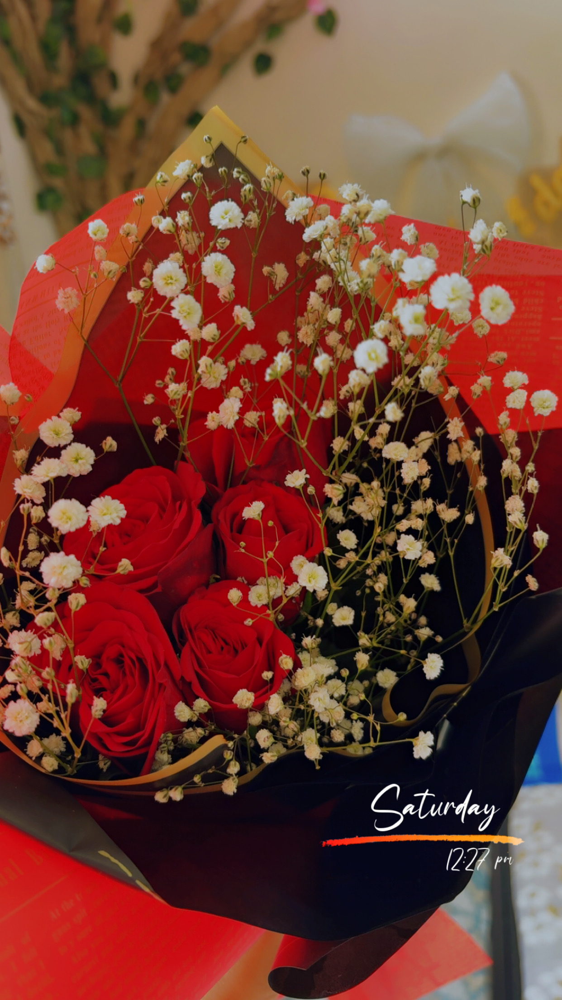
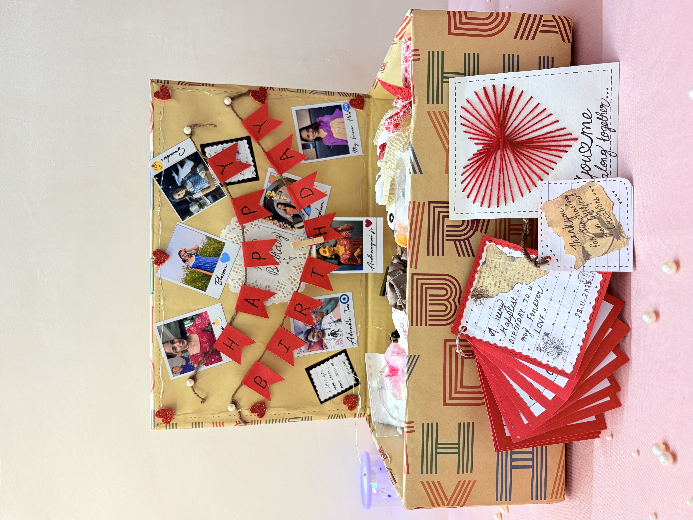
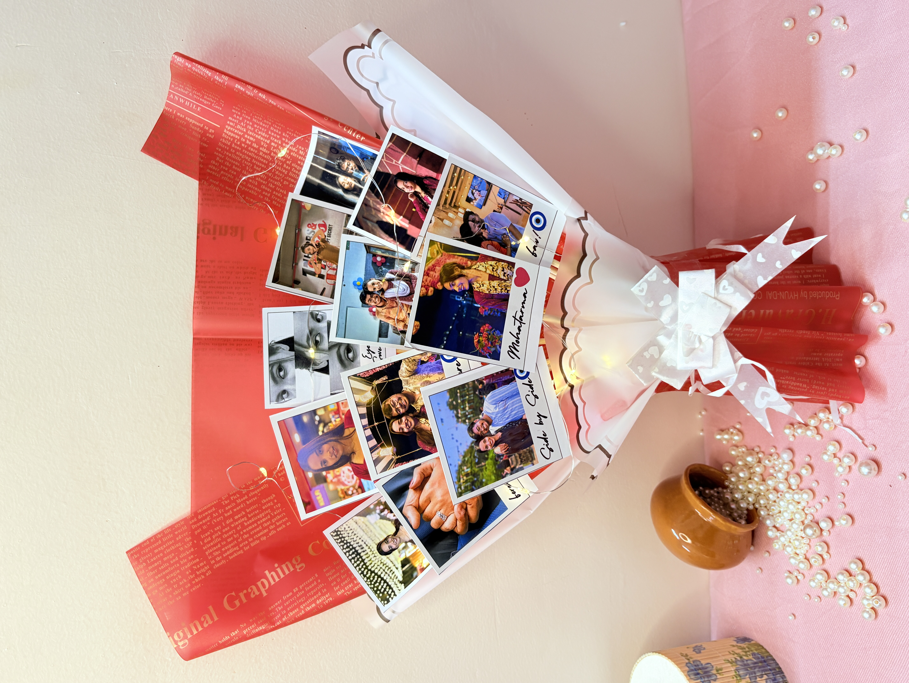
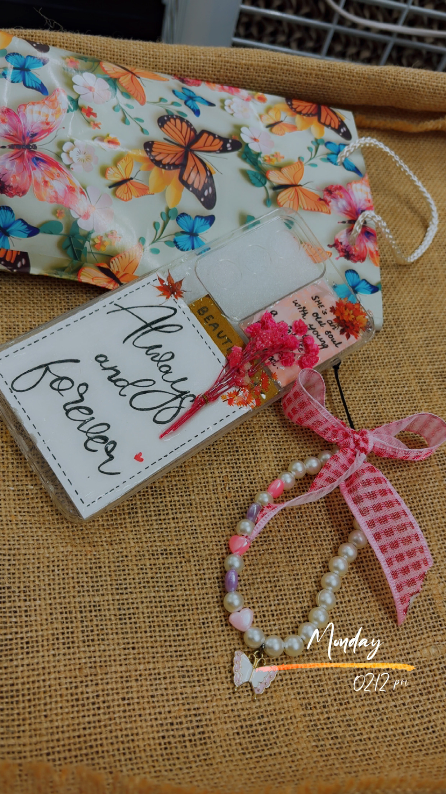

# 🎁 Gift Glow Creations

## 🎀 Our Handmade Product Gallery

Explore our collection of handmade and customised creations, designed with love by Gift Glow Creations.

| Product 1 | Product 2 |
|:---:|:---:|
|  |  |

| Product 3 | Product 4 |
|:---:|:---:|
|  |  |

✨ Every creation is handmade with love, creativity and care.

## 👩‍💻 Project Team & Contributions

| Team Member | Contribution |
|---|---|
| **Seha Parasher** | Major contribution to overall project planning, product ideas and designs, coordination of project activities, and presentation/documentation. |
| **Diksha Chaubey** | Major contribution to business planning, customisation ideas, branding and Instagram strategy, and preparing the project content and presentation. |
| **Kunal Rathore** | Bringing and arranging the raw materials required to make the handmade products. |
| **Puja Singh** | Supporting the team with product preparation, packaging, and other project tasks as needed. |

**Note:** Seha Parasher and Diksha Chaubey made the leading contributions to the project, while all team members supported its completion.


## Handmade E-Commerce Business

> **"Turning creativity into a business, one handmade product at a
> time."**

**Gift Glow Creations** is a student-led handmade e-commerce project
that explores how a creative idea can be transformed into a practical
online business. The project combines **handmade production, e-commerce,
digital marketing, branding, customer communication, pricing, packaging,
and entrepreneurship**, with Instagram serving as the primary digital
storefront.

The business focuses on **affordable, attractive, creative, and
personalised handmade gifts** that make gifting more meaningful.

------------------------------------------------------------------------

## 📌 Project Overview

  Detail                 Information
  ---------------------- -----------------------------------------
  **Project Title**      Handmade E-Commerce Business
  **Brand Name**         Gift Glow Creations
  **Business Type**      Handmade E-Commerce
  **Business Model**     Direct-to-Consumer (D2C)
  **Primary Platform**   Instagram
  **Product Category**   Handmade & Customised Gifts
  **Target Market**      Students, young adults and gift buyers
  **Course**             Bachelor of Computer Applications (BCA)
  **Semester**           5th Semester
  **Department**         CSIT
  **University**         Guru Ghasidas Vishwavidyalaya, Bilaspur
  **Academic Session**   2026--27

------------------------------------------------------------------------

## 🌸 About Gift Glow Creations

Gift Glow Creations is based on the idea that gifts become more
memorable when they feel personal. Instead of focusing only on
mass-produced items, the business offers handmade and customised
products that can be adapted according to a customer's preferred
**colour, theme, occasion, name, message, or design**.

The project also demonstrates how a small business can begin with
limited infrastructure. Instead of requiring a physical store at the
initial stage, products can be displayed online, promoted through social
media, and ordered through direct customer communication.

The brand is built around three core ideas:

-   🎨 **Creativity** --- visually attractive and distinctive handmade
    designs.
-   💝 **Personalisation** --- products customised according to customer
    preferences wherever possible.
-   💰 **Affordability** --- products designed to remain accessible,
    especially for students and young customers.

### Our Value Proposition

> **"Cute, creative and personalised handmade products that make gifting
> more meaningful."**

------------------------------------------------------------------------

## 🎯 Project Objectives

The primary objective is to understand and practically implement the
basic operations of a small handmade e-commerce business using Instagram
as the main digital platform.

The project aims to develop an understanding of:

-   E-commerce and the use of social media for business.
-   Product selection, development and presentation.
-   Customer requirements and target-market identification.
-   Product costing, pricing and profit calculation.
-   Digital marketing, product photography and promotional content.
-   Customer communication, order handling, packaging and delivery.
-   Branding and maintaining a consistent online identity.
-   Business strengths, weaknesses, opportunities and threats.
-   Practical entrepreneurial skills needed to turn creativity into a
    business.

------------------------------------------------------------------------

## 🛍️ Products & Services

The business focuses on small handmade and gift-oriented products that
are visually appealing, customisable and suitable for different
occasions.

### 🎀 Handmade Charms & Keychains

Small decorative products that can be attached to bags, pouches, keys
and other personal belongings. They are lightweight, affordable and can
be created in different colours, themes and designs.

### 🎁 Customised Gift Hampers

Gift hampers combine multiple small products into one attractive
package. They can be prepared for birthdays, anniversaries, festivals,
friendship occasions, farewells and other celebrations. Customers may
choose a theme, colour combination or budget.

### 🧸 Cute Accessories & Decorative Products

Small lifestyle and decorative accessories inspired by customer
preferences and current trends. Their visual nature makes them
especially suitable for Instagram photographs, stories and reels.

### 💝 Personalised Gifts

Customisation is an important feature of the business. Products may be
personalised using:

**Names • Initials • Colours • Themes • Personal Messages •
Occasion-Specific Designs**

This can give the product greater personal value than a completely
generic gift.

------------------------------------------------------------------------

## 👥 Target Market

Gift Glow Creations is mainly designed for customers who appreciate
creative, affordable and personalised gifting options.

-   **College Students** looking for affordable gifts for friends,
    birthdays and farewell events.
-   **Teenagers & Young Adults** interested in aesthetic, trendy and
    personalised products.
-   **Gift Buyers** searching for meaningful gifts for birthdays,
    anniversaries, festivals and special occasions.
-   Customers who value **attractive design, customisation, good
    packaging, reasonable prices, quick communication and easy
    ordering**.

------------------------------------------------------------------------

## ⚙️ How the Business Works

Gift Glow Creations follows a **Direct-to-Consumer (D2C)** model.
Customers interact directly with the business rather than purchasing
through a traditional distributor or physical retail store.

### Business Process

``` text
Creative Idea
     ↓
Product Design
     ↓
Raw Material Procurement
     ↓
Handmade Production
     ↓
Quality Check
     ↓
Product Photography
     ↓
Instagram Promotion
     ↓
Customer Enquiry
     ↓
Order & Customisation Confirmation
     ↓
Payment
     ↓
Packaging
     ↓
Delivery
     ↓
Customer Feedback
```

This represents the complete journey of a handmade product from the
initial idea to delivery and customer feedback.

------------------------------------------------------------------------

## 📱 Instagram as Our Digital Storefront

Instagram is the primary platform used in the project because handmade
products depend strongly on visual presentation. It allows the business
to display products, build a brand identity and communicate directly
with customers without initially requiring a physical store.

### Instagram Content

-   **Posts** for product photographs, collections and announcements.
-   **Reels** for product creation, close-ups, packaging and new
    arrivals.
-   **Stories** for polls, offers, customer interaction and
    behind-the-scenes content.
-   **Highlights** for Products, Prices, Reviews, Custom Orders, Offers
    and Contact details.
-   **Direct Messages** for customer enquiries and order communication.

**Instagram Handle:** `@GiftGlowCreations`

------------------------------------------------------------------------

## 📣 Digital Marketing Strategy

Creating a good product is only one part of an online business.
Customers also need to discover the brand and understand what makes its
products different.

### 📸 Product Photography

Since customers cannot physically inspect a product before ordering,
photographs should clearly present its **design, colour, size, details
and packaging**. Good lighting and clean presentation can make products
more attractive online.

### 🎥 Reels & Behind-the-Scenes Content

Short videos can present the handmade journey in an engaging way:

`Raw Materials → Making Process → Finished Product → Packaging`

This content highlights the effort involved in handmade production and
helps communicate the identity of the brand.

### 🏷️ Hashtags & Stories

Relevant hashtags can help categorise content and support
discoverability:

`#GiftGlowCreations` `#HandmadeGifts` `#HandmadeBusiness` `#CustomGifts`
`#HandmadeCharms` `#GiftHampers`

### 🎉 Occasion-Based Marketing

Special collections can be introduced around birthdays, festivals,
Valentine's Day, Friendship Day, anniversaries and farewell events.

### 🤝 Word-of-Mouth

For a small business, positive customer experiences and recommendations
can help establish initial trust and bring new customers.

------------------------------------------------------------------------

## 💰 Cost Structure & Pricing

Pricing needs to balance affordability for customers with the actual
cost of creating and delivering handmade products.

### Main Cost Components

-   **Raw Materials:** beads, ribbons, paper, flowers and other
    materials.
-   **Production Cost:** tools, supplies, time and effort involved in
    handmade production.
-   **Packaging:** boxes, wrapping, tissue paper, ribbons, cards and
    stickers.
-   **Delivery:** shipping or local delivery expenses.
-   **Marketing:** promotional and content-related expenses.

### Pricing Formula

``` text
Selling Price = Total Cost + Profit Margin
```

The project uses a general **30--50% profit-margin approach**, depending
on product type and customisation.

An example cost calculation from the project report is:

  Component             Example Cost
  ------------------- --------------
  Raw Material                   ₹60
  Packaging                      ₹20
  Miscellaneous                  ₹10
  **Total Cost**             **₹90**
  **Selling Price**         **₹150**
  **Gross Profit**           **₹60**

> These values are examples. Actual costs vary according to materials,
> product type, packaging, labour/time, delivery and customisation.

The project presentation estimates a minimum startup investment of
approximately **₹4,000--₹5,000**, supporting the idea that the business
can begin on a relatively small scale.

------------------------------------------------------------------------

## 📦 Order, Packaging & Delivery

A clear order process helps reduce confusion and improves the customer
experience:

**View Product → Enquiry → Price & Details → Customisation → Order
Confirmation → Payment → Preparation → Quality Check → Packaging →
Delivery → Feedback**

Packaging is particularly important because many products are purchased
as gifts. Depending on the product, packaging may include decorative
boxes, tissue paper, ribbons, thank-you cards, brand stickers and
protective wrapping.

------------------------------------------------------------------------

## 💬 Customer Service

Since most interaction takes place digitally, customer service should
focus on:

-   Responding to enquiries within a reasonable time.
-   Clearly communicating price, size, availability and customisation
    options.
-   Explaining payment and delivery details before confirmation.
-   Maintaining polite, professional and friendly communication.
-   Collecting feedback about product quality, design, packaging and
    delivery.

Feedback can help identify areas for improvement and understand future
customer requirements.

------------------------------------------------------------------------

## 📊 SWOT Analysis

  -----------------------------------------------------------------------
  💪 Strengths                        ⚠️ Weaknesses
  ----------------------------------- -----------------------------------
  Unique handmade products            Handmade production takes time

  Creative and customisable designs   Limited production capacity

  Low initial infrastructure          Small initial customer base
  requirement                         

  Direct customer interaction         Dependence on social-media
                                      visibility

  Visually suitable for Instagram     Limited marketing budget

  Flexible small-scale model          Maintaining consistency can be
                                      difficult
  -----------------------------------------------------------------------

  🚀 Opportunities                    🛡️ Threats
  ----------------------------------- --------------------------------
  Online and customised gifting       Strong competition
  Festival and seasonal collections   Mass-produced alternatives
  Influencer collaborations           Increasing material costs
  Event and corporate gifting         Changing customer trends
  Dedicated website development       Delivery-related problems
  Expansion to more platforms         Social-media algorithm changes

------------------------------------------------------------------------

## 🚧 Challenges & Possible Solutions

  -----------------------------------------------------------------------
  Challenge                           Possible Approach
  ----------------------------------- -----------------------------------
  Low initial reach                   Consistent content and promotion

  High competition                    Unique designs and customisation

  Limited production time             Pre-planning and inventory
                                      management

  Product damage                      Better protective packaging

  Rising material costs               Compare suppliers and optimise
                                      designs

  Customer hesitation                 Reviews and product demonstrations

  Social-media dependence             Gradually build a website and
                                      customer database
  -----------------------------------------------------------------------

The project also recognises the challenge of balancing studies with
business activities while maintaining product quality and timely
delivery.

------------------------------------------------------------------------

## 🚀 Future Scope & Roadmap

### 01 --- Expand the Product Range

Future categories could include handmade jewellery, crochet products,
stationery, room décor, personalised photo gifts and seasonal
collections.

### 02 --- Build a Multi-Platform Presence

The business can gradually expand beyond Instagram to **Etsy, Amazon
Handmade and a dedicated website**. A future website could include a
product catalogue, shopping cart, online payments, order tracking and
customer accounts.

### 03 --- Influencer Collaborations

Collaborations with micro-influencers and content creators can help the
brand reach new audiences.

### 04 --- Event, Bulk & Corporate Orders

The business can explore orders for college events, birthdays, weddings,
return gifts and corporate events.

### 05 --- Stronger Brand Identity

A consistent **logo, packaging style, colour palette, typography and
photography style** can help create a recognisable brand.

### 06 --- Scale Up

The long-term plan is to increase production capacity, build a small
team and work toward the project's stated goal of **₹1 lakh+ monthly
revenue** as the business develops.

------------------------------------------------------------------------

## 🎓 Learning Outcomes

This project provides practical exposure to several areas of online
business.

**Business Learning:** costing, pricing, revenue, profit, customer
acquisition and business planning.

**Digital Marketing Learning:** branding, product promotion, customer
engagement, content creation and product presentation.

**Entrepreneurial Learning:** understanding the importance of
creativity, planning, consistency, customer understanding and
adaptability.

**Teamwork:** dividing responsibilities such as photography,
social-media management, packaging, documentation and customer
communication.

> **Creativity + Planning + Consistency + Customer Understanding +
> Adaptability**

------------------------------------------------------------------------

## 🌟 Project Vision

Gift Glow Creations demonstrates how a small creative idea can be
developed into a practical online business by combining handmade skills
with digital platforms and basic business planning.

The model is flexible: the business can begin with a limited product
range and relatively low infrastructure, learn from customer feedback,
and gradually expand into more products, platforms and markets.

> **"Small handmade creations, made to make someone smile."**

------------------------------------------------------------------------

**Course:** BCA --- 5th Semester\
**Department:** CSIT\
**University:** Guru Ghasidas Vishwavidyalaya, Bilaspur\
**Academic Session:** 2026--27\
**Faculty Advisor:** Prof. Ratnesh Srivastava

------------------------------------------------------------------------

## 📬 Connect With Gift Glow Creations

**Instagram:** `@GiftGlowCreations`

Follow Gift Glow Creations for handmade gifts, customised creations, new
products and special collections.

------------------------------------------------------------------------

::: {align="center"}
## 💗 Thank You!

### Gift Glow Creations

**Handmade with creativity. Personalised with care.**

*Made by hand, shared with heart.*
:::
